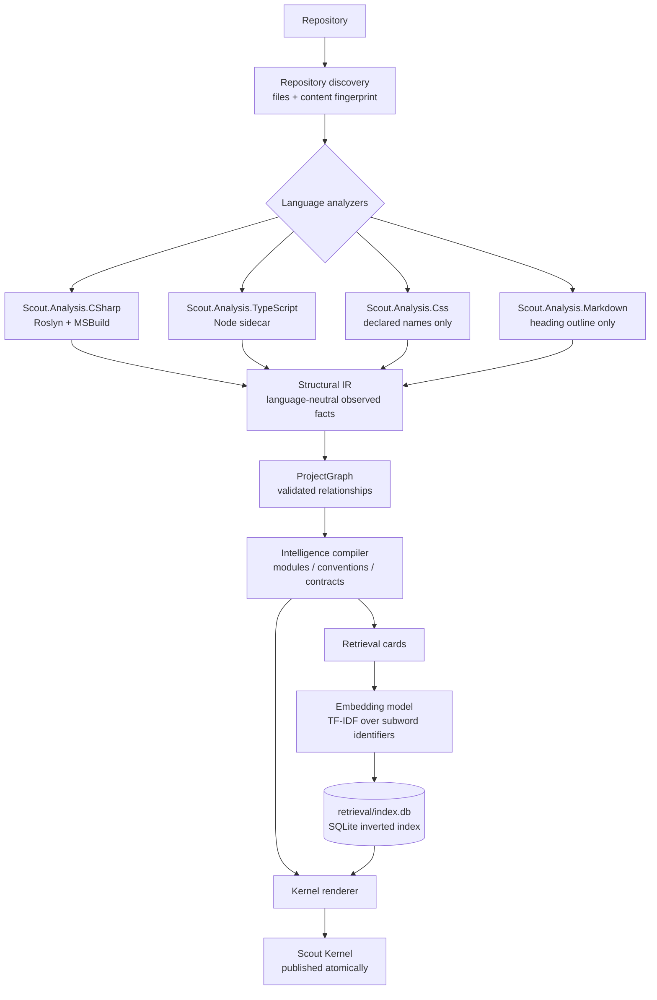
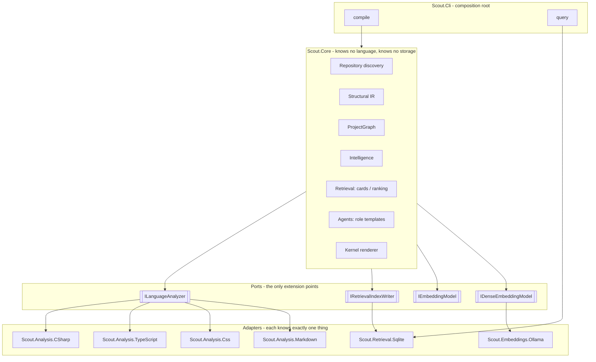
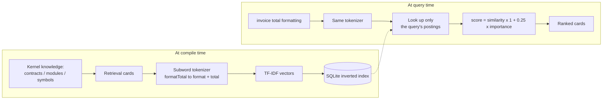
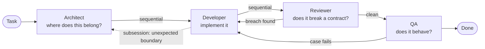

# Scout

Scout compiles a software repository into a small, agent-native **project intelligence kernel**.

It is infrastructure for coding agents. Instead of putting a whole project in a prompt, or letting an agent grep its way around until it has burned its context, Scout compiles the repository **once** into a compact artifact the agent can **ask questions of**.

---

## The problem it solves

A coding agent asked to fix a bug in an unfamiliar repository does roughly this:

```text
list files -> open a few -> grep -> open a few more -> guess -> change something -> hope
```

Every step costs tokens, most of them spent discovering things that were already true before the task started. Worse, the agent stops exploring when its context fills up, not when it has understood the code — so it changes a symbol without knowing who depended on it.

Scout moves that discovery **out of the agent's context and into a compiled artifact**:

```text
compile once  ->  ask a question  ->  open only what the answer names
```

Measured on Scout's own repository:

| | characters |
| --- | --- |
| Repository source | 434,197 |
| Kernel index files | 38,234 |
| **One query's answer** | **2,840** |

The question *"how are kernel artifacts published atomically"* returns `KernelFilePublisher.PublishAsync` as its first result. The agent opens one file instead of searching for it.

---

## What it is not

- It is **not** a code search tool. It answers with established knowledge, not with matching lines.
- It is **not** a summarizer. Nothing in the kernel is produced by a language model; every claim carries the evidence it came from.
- It is **not** an agent framework. It produces context and role definitions; it does not run them.

---

## The core idea: facts, claims, and unknowns are separate

Most context tools flatten everything into one confident blob of prose. Scout keeps three things apart on purpose:

| Layer | What it holds | Can it be wrong? |
| --- | --- | --- |
| **Structural IR** | Observed code facts — declarations, calls, imports, JSX elements | No. If it is in the IR, an analyzer saw it. |
| **Intelligence** | Claims derived from facts — modules, conventions, contracts | Yes, and each carries confidence, scope, and evidence IDs. |
| **Unknown areas** | What Scout could not establish | Explicit. Listed, never guessed. |

That separation is the whole design. An agent that cannot tell a fact from a guess will act on the guess.

### The three kinds of intelligence

- **Modules** — observed boundaries grouping source files.
- **Conventions** — recurring shapes, with their support, population, and exceptions.
- **Contracts** — symbols that **already have consumers depending on their shape**, with the blast radius of changing them.

A contract is not a declaration that merely looks public. It is a declaration that is **already being depended on**:

```text
invoice-table   shared-type    blast radius 2
  consumers: InvoiceTable, InvoiceSummary
```

That is the question an agent actually needs answered before it touches something.

---

## Compilation flow



Each stage only consumes the stage before it. **Kernel rendering never performs new analysis** — if a fact is not in the IR, it cannot appear in the kernel.

---

## Architecture



The rule that holds the whole thing together:

> `Scout.Core` never learns a language and never learns a storage format.

`ScoutCompiler` asks every analyzer for its input extensions and merges their contributions. Adding Python means adding one adapter and touching nothing else. That constraint has been validated five times now — C#, TypeScript, CSS, Markdown, and SQLite.

### Projects

| Project | Sole responsibility |
| --- | --- |
| `Scout.Core` | Facts, graph, intelligence, retrieval scoring, agent roles, kernel projection |
| `Scout.Analysis.CSharp` | The only project that knows Roslyn and MSBuild |
| `Scout.Analysis.TypeScript` | The only project that knows the TypeScript compiler API |
| `Scout.Analysis.Css` | The only project that knows CSS syntax |
| `Scout.Analysis.Markdown` | The only project that knows Markdown syntax |
| `Scout.Retrieval.Sqlite` | The only project that knows a storage format |
| `Scout.Embeddings.Ollama` | The only project that knows a local Ollama server |
| `Scout.Cli` | Composition root and command-line boundary |
| `Scout.Tests` | Validates every slice through package-free fixtures |

---

## Supported languages

| Language | Analyzer | Inputs | How facts are obtained |
| --- | --- | --- | --- |
| C# | `Scout.Analysis.CSharp` | `.sln`, `.slnx`, `.csproj`, `.cs` | Roslyn and MSBuild, in process |
| TypeScript, JavaScript, React | `Scout.Analysis.TypeScript` | `.ts`, `.tsx`, `.mts`, `.cts`, `.js`, `.jsx`, `.mjs`, `.cjs` | A Node sidecar driving the TypeScript compiler API |
| CSS | `Scout.Analysis.Css` | `.css` | A scanner that reports declared names only |
| Markdown | `Scout.Analysis.Markdown` | `.md`, `.markdown` | A scanner that reports the heading outline only |

The TypeScript analyzer runs **out of process on purpose**. Reimplementing module resolution and type checking in C# would produce plausible but unverified relationships, which is worse than reporting nothing. The sidecar resolves `typescript` from the analyzed repository first and falls back to its own vendored copy, so Scout works on repositories with no installed dependencies.

`node` must be on `PATH`. When it is not, the analyzer contributes an error diagnostic and no facts. A mixed repository still compiles from the languages that succeeded; a TypeScript-only repository fails loudly, because a kernel with no symbols would misrepresent the project.

**React is observed rather than assumed.** A `.tsx`/`.jsx` declaration with a PascalCase name and JSX in its body is recorded with the native kind `react-component`, and each JSX element becomes a `renders` relationship. Visibility follows the module system — exported is public, non-exported is private.

**Wording is observed too.** The text a project shows to people — JSX text, JSX attribute values such as `label` or `placeholder`, and the strings a declaration carries, template literals included — is reported as a `text-literal` symbol linked to the declaration that holds it, so a question phrased in the product's own words ("Solicitar información") reaches the component that renders it. A string counts as wording only when it is longer than three characters, holds a letter, and reads as prose: a single capitalised word, or mostly prose words. Class lists, paths, URLs, identifiers and constants fail that test without any list of names to maintain. Module specifiers, property keys, literal types, directives, tagged templates and attributes such as `className`, `href` or `data-*` are never wording. Only the fixed parts of a template are kept, text is whitespace-normalised and capped at 200 characters, and a file reports at most 300 texts (`TS_TEXT_LITERAL_LIMIT` says when it clipped).

**JavaScript** is analyzed by the same sidecar, because the TypeScript compiler parses untyped sources natively. It is still reported as JavaScript: files carry `javascript` or `javascriptreact`, and a project whose only manifest is `package.json` is a JavaScript project. What is missing is only what the source never declared — type annotations, and therefore the `implements` edges an interface would give.

**CSS is reported as names, not as computed style.** The analyzer records the class names and custom properties a style sheet declares; it never resolves the cascade, specificity or computed values, because those depend on document structure no style sheet contains. Class names in `*.module.css` are rewritten by the bundler, so they stay file-scoped and private instead of being published under a name that does not survive the build.

**Markdown is reported as an outline, not as prose.** The analyzer records each ATX heading (`#` to `######`) as a `markdown-section` symbol nested under the heading that encloses it, so a query about documentation points at the section to open instead of the whole file. Section bodies are never read, in keeping with the rest of the kernel, and sections carry no visibility because a document does not declare one. Headings inside front matter, fenced code blocks, HTML comments and indented code are skipped, and Setext headings (underlined with `===` or `---`) are not read. Sections with the same outline path in one file stay distinct (`Deployment`, `Deployment (2)`). Links between documents are not followed.

### Documentation as stated intent

A section whose title names a topic (architecture, conventions, contracts, concerns, flows, decisions, operations, testing) is reported as a **documented intent**: a `Recommendation` with a confidence of 0.5, the scope of the code its document speaks for, and the evidence of the heading it came from. The match is lexical, in English and Spanish and ignoring accents, and the section body is never read, so the claim says where the project speaks about a topic and nothing about what it says.

Documented intent lives in its own `documentation/index.json` and its own `documentation` retrieval cards. It is never merged into `conventions/` or `contracts/`, and it never removes an entry from the unknown areas: a documented flow is still an unobserved flow. The Architect, Developer, Reviewer and QA role templates read the index and retrieve `--kind documentation` only when the kernel actually has documentation, and each is told to treat it as unverified and to trust an observed contract or convention over a document that disagrees. Document formats other than Markdown join in by reporting symbols of kind `document-section`; nothing in `Scout.Core` knows Markdown.

### References that cross a language boundary

A React component naming a class in `className` is observed by the TypeScript analyzer, while the declaration of that class is observed by the CSS analyzer. Neither analyzer may read the other language, so they **agree on a shared vocabulary** instead: both derive the same identifier from the same logical key through `SharedSymbolKey`.

Only literal class lists are linked — a computed `className` depends on runtime state and is left unreported rather than guessed.

When the declaring analyzer does not run, the reference stays unresolved. `ScoutCompiler` drops it and records an `UNRESOLVED_RELATIONSHIP_ENDPOINT` warning instead of failing the compilation or inventing the missing declaration.

---

## Usage

### Build and test

```text
dotnet build Scout.slnx --configuration Release
dotnet test Scout.slnx --configuration Release --no-build
```

### Compile or refresh a repository kernel

```text
dotnet run --project src/Scout.Cli -- compile <repository> [--output <path>] [--no-index] [--update] [--embeddings ollama[:<model>]]
dotnet run --project src/Scout.Cli -- update <repository> [--output <path>] [--no-index] [--embeddings ollama[:<model>]]
```

A C# repository must be SDK-style and loadable by an installed .NET SDK; restore it before compilation. A TypeScript repository needs no installed dependencies, but `node` must be available. Style sheets need nothing.

The default output is a sibling directory named `<repository>.scout`.

The update path is the pipeline-friendly refresh mode: it writes a fresh kernel into the same output directory using the same atomic replacement strategy as the standard generation step, so a valid kernel stays available while the new one is swapped in. That keeps CI and scheduled refreshes from leaving a stale or deprecated artifact behind.

### Ask the kernel instead of reading it

```text
dotnet run --project src/Scout.Cli -- query "<intent>" --kernel <kernel-path> [--limit <n>] [--kind contract|module|symbol|documentation|text|file] [--json] [--no-embeddings]
```

```text
$ scout query "invoice table css class" --kernel ./app.scout --kind contract --limit 1

[contract] invoice-table  (0.549)
  path:   src/invoices.css
  what:   shared-type with 2 consumer(s) across 1 module, established by observed usage.
          Changing its shape affects every listed consumer.
  usedBy: InvoiceSummary, InvoiceTable
  detail: contracts/contract-6f75b892....json
```

Use `--json` when an agent is the consumer. Add `--profile` to print how long opening the index and searching it took, to stderr.

### One call for "where do I edit", and the exact lines once you know

```text
dotnet run --project src/Scout.Cli -- brief "<task, in your own words>" --kernel <kernel-path> [--repository <path>] [--limit <n>] [--max-tokens <n>] [--json] [--format compact]
dotnet run --project src/Scout.Cli -- read "<symbol>"|"<file>:<start>-<end>" --kernel <kernel-path> [--repository <path>] [--max-lines <n>] [--json] [--format compact]
```

`brief` runs one retrieval call and returns edit sites (file, symbol, line, the names connected to it) within a
token budget (`--max-tokens`, default 600) — the lowest-priority sites are dropped to fit, rather than
returning something larger than asked for. It says plainly that it checks no rule mechanically yet, instead of
silently omitting a rules section (that lands in a later phase).

`read` returns exactly the lines a symbol or a `file:start-end` range names, read from the live repository —
a kernel never stores source bodies. `--repository` defaults to the kernel path with its trailing `.scout`
removed; pass it explicitly otherwise. Warns when the source file changed since compile, since the recorded
line numbers may no longer match.

`neighbors "<symbol>" --kernel <path> [--depth <n>] [--path "<target>"] [--explain "<target>"]` is provisional: it
walks the reader/read names a card already records. It cannot tell edge kind or direction.

### Use Scout from Claude Code

`scout mcp` runs a stdio MCP server exposing exactly three tools — `scout_brief`, `scout_read`,
`scout_neighbors` — each backed by the same code as its CLI command. Register it either way:

```text
claude mcp add scout -- scout mcp
```

```json
{ "mcpServers": { "scout": { "command": "scout", "args": ["mcp"] } } }
```

(the JSON is a `.mcp.json` at the project root). Each tool takes the kernel path as an argument.

`scout install claude --kernel <path> [--project|--user] [--hook-matcher <pattern>] [--dry-run] [--uninstall]`
wires a kernel into Claude Code without hand-editing anything:

- a CLAUDE.md section of at most 15 lines between `<!-- scout:begin -->` and `<!-- scout:end -->`;
- a PreToolUse hook (`.claude/scout-hooks/`) that never blocks and prints at most 3 lines;
- copies of the kernel's `scout-agents` and `scout-query` skills under `.claude/skills/`;
- an install manifest (`.claude/scout-install-manifest.json`) recording what was written.

It is idempotent (a second run changes nothing), `--dry-run` writes nothing, and `--uninstall` removes only
what the manifest recorded, leaving your own CLAUDE.md and settings content intact. `scout update` resyncs the
installed skills when a manifest for that kernel is present. `--project` is the default; `--user` targets the
home directory's `.claude`.

---

## How retrieval works



**What is indexed, and what is not:**

- Cards are projections of knowledge the kernel already established. Each names a path, what depends on it, and the detail file to open next.
- **Source bodies are never indexed.** Returning a body would hand back the tokens the kernel exists to avoid; the body is what the agent opens *afterwards*.
- **Symbol cards name their neighbours in both directions.** A symbol lists up to eight declarations that call, reference or render it, and a callable lists up to 24 names it works with (style classes excluded). Reading `model.version` is observed as a use of the declared field, not only of the type that holds it, so a question about what is shown can reach the component that shows it. A symbol many declarations read also ranks above a same-named one nobody reads.
- **File cards answer "which file do I open".** Each source file that declares something has one `file` card gathering what it declares, what its callables read and the first wording it shows, all capped. Retrieve them with `--kind file`.
- **Wording is indexed, bounded, and kept apart.** A `text` card holds one observed piece of user-visible wording, its path and line, and the declaration that holds it. It is a fragment the project chose to show, not a body, and it only points at the declaration. It ranks below declarations, is never a navigation target or a contract, and is excluded from the declared-symbol counts of modules and the kernel. Retrieve it on its own with `--kind text`.
- A symbol that is already a contract is not indexed twice, so it does not split similarity with its own richer card.
- **Neighbour names are indexed on purpose.** An agent usually knows the symbol it is holding, not the boundary that governs it — so naming a consumer has to be enough to surface the contract above it.

**Why an inverted index and not dense vectors:** with a vocabulary of identifiers, a query touches only the postings of its own terms. Cost follows the question, not the size of the repository.

**Why lexical TF-IDF by default:** it is deterministic, needs no network, no API key, and no download, so the kernel stays reproducible and self-contained. It is honest about its limit — **it matches wording, not meaning**. That costs less here than it would over prose, because identifiers, paths, and summaries share a vocabulary with the questions asked about them.

### Semantic search (opt-in)

Lexical retrieval matches wording, so "whatsapp link" cannot find `waLink`: they share no word. A kernel built with
`--embeddings ollama` also carries a **dense vector per card**, and a query is answered by fusing both rankings.

```text
scout compile <repository> --embeddings ollama            # default model: bge-m3 (multilingual)
scout compile <repository> --embeddings ollama:<model>
scout query "whatsapp link" --kernel <kernel>             # hybrid when the model answers, lexical otherwise
```

- **It is never required.** Without `--embeddings`, a compile needs no model, no network and no service, and is as
  deterministic as before. A kernel built with them is still queried on a machine that has no Ollama: the answer is
  lexical, and a `notice` (stderr for the CLI, a field in `--json`) says what was missing. `--no-embeddings` forces it.
- **A compile that asks for embeddings and cannot get them fails**, with what to do (`ollama serve`,
  `ollama pull <model>`), instead of quietly publishing a kernel without them.
- **Fusion is by rank, not by value.** Lexical similarity and cosine similarity are on different scales, so the two
  rankings are merged by reciprocal rank (offset 20, depth 50) and the card's prior tilts the result as before. A card
  both channels like rises above one only a channel liked.
- **Dense vectors are stored quantized** (one byte per component plus a scale) in a `dense_vectors` table that exists
  only when there are vectors, and scanned exhaustively: a dense vector shares every dimension with every other, so an
  inverted index would read them all anyway. The index records the model that made them (`denseModelId`), and a query
  is only embedded with that same model.
- **A cache makes a refresh cheap.** Vectors are cached per machine by model and by the hash of the text, in chunks, so
  an interrupted run resumes and an `update` embeds only the cards that changed. The first run is the expensive one:
  on a CPU-only machine `bge-m3` embeds roughly one card per second, so a repository of several thousand cards takes
  on the order of an hour (progress is printed).
- **The agent skills do the same in plain Node.** `scout-query` and `scout-agents` read the vectors, embed the query
  through `OLLAMA_HOST` when it is reachable, and fuse with the same constants; otherwise they answer lexically.

`IEmbeddingModel` still produces the sparse vectors the inverted index is built on; `IDenseEmbeddingModel` is a second,
separate port for dense models, so another provider (an embedded ONNX model that needs no service, a hosted API) is
one more adapter and changes nothing else.

**Why SQLite:** one portable file, self-describing, with a driver in every language. An agent with a database tool can query it without going through Scout at all.

---

## Agent roles

`agents/index.json` holds role templates specialized against the compiled kernel.



Two handoff modes:

- **`sequential`** — control passes on and does not come back. The sender's work is finished.
- **`subsession`** — a bounded sub-session answers one question and **returns control to the caller, which keeps its context**. Used when a role needs another role's judgement without giving up ownership of the task.

Each role reads a **projection** of the kernel, not all of it:

| Role | Reads | Retrieves |
| --- | --- | --- |
| Architect | `KERNEL.md`, architecture, modules, contracts | modules, contracts |
| Developer | `KERNEL.md`, contracts, conventions | contracts, symbols |
| Reviewer | `KERNEL.md`, contracts, conventions | contracts, symbols |
| QA | `KERNEL.md`, contracts | contracts |

That restriction is what keeps a multi-agent run cheaper than one agent reading everything.

### Specialization is real, not cosmetic

A generic role prompt tells an agent what a reviewer is. A specialized one tells it what reviewing **this** repository means. Generated against a kernel with six contracts and no established conventions:

```json
{
  "id": "reviewer",
  "obligations": [
    "Query 'retrieval/index.db' before opening any file; open source only for what it returns.",
    "For each changed symbol, retrieve its contract and confirm every consumer of the 6 contracts was handled.",
    "Reject any claim the kernel does not support. 'Probably unused' is not a finding; an empty consumer list is.",
    "No conventions were established, so no deviation can be reported as one."
  ],
  "handoffs": [
    { "targetRoleId": "developer", "mode": "sequential", "condition": "A contract breach or an unhandled consumer was found." },
    { "targetRoleId": "qa",        "mode": "sequential", "condition": "No contract breach remains." }
  ]
}
```

The last obligation is the point. The reviewer **cannot** report a convention deviation, because no convention was ever established. A generic prompt would have invented one.

### They are data, not a framework

Templates are emitted as JSON because the choice of runtime belongs to whoever runs the agents. The same file can drive a hand-written loop, a graph runtime, or the agent you are already using. Scout decides *what each role must verify*; it does not decide what you run it with.

---

## The kernel layout

```text
<repository>.scout/
├── KERNEL.md                  entry point
├── AGENTS.md                  how an agent should use this kernel
├── manifest.json              format, capabilities, entrypoints, what is unknown
├── retrieval/
│   └── index.db               <- query this first
├── agents/
│   ├── index.json
│   └── architect.json  developer.json  reviewer.json  qa.json
├── architecture/overview.md
├── modules/                   index.json + one file per module
├── contracts/                 index.json + one file per contract
├── conventions/               index.json + one file per convention
├── evidence/                  index.json + one file per evidence record
└── .internal/                 complete structural IR and intelligence
```

Publication is atomic: the kernel directory is only replaced once every artifact exists, and Scout refuses to overwrite a directory that is not already a Scout Kernel.

---

## What is missing

Scout is honest about its own gaps in the same way it is honest about a repository's. `manifest.json` lists every capability it does **not** have.

### Not built

| Capability | Status | What it would take |
| --- | --- | --- |
| **Agent runtime** | Not built — **and deliberately so** | The agent you already use (Copilot CLI, Cursor, Claude Code) *is* the runtime. It already has an LLM, function calling, sub-agents, and state. Building another would duplicate it and lock you in. |
| **Skills** | Not built | Requires a `Scout.Analysis.Git` analyzer to derive procedures from commit history. |
| **Concerns** | Not built | Cross-cutting aspects (logging, auth, caching) as first-class claims. |
| **Flows** | Not built | End-to-end execution paths across module boundaries. |
| **Canonical examples** | Not built | "Do it like this file" — needs a quality signal Scout does not yet have. |
| **Task routing** | Not built | Retrieval is not routing. Retrieval finds relevant cards; routing decides which role owns a task. |
| **Freshness** | Not built | Every claim carries a freshness field, but nothing yet computes decay from git history. |

### Known limits of what *is* built

- **The default embedding is lexical.** It matches wording, not meaning. Ask for `formatTotal` and it works; ask "how do I make money display nicely" and it may not. `--embeddings ollama` adds meaning, but needs an Ollama with an embedding model on the machine that compiles and, to benefit, on the machine that queries.
- **Semantic search is experimental: it has not been shown to improve ranking yet.** Measured on 13 expected files drawn from real bug reports of a 500-file React application, `bge-m3` fused at any weight left the files found in the top eight unchanged (10 of 13), and at weights of 0.15 and above it displaced a lexical lead. Its similarities cluster narrowly (0.5 to 0.67) and a card of a function says what it is called, not what it does, so an abbreviation such as `waLink` for "whatsapp link" stays out of reach. What did move the number were observed facts: wording, member reads and file cards. Treat `--embeddings` as an option to evaluate on your repository, not as an upgrade.
- **Semantic search has no similarity floor yet.** A dense model always has a nearest card, so a question about something the repository never mentions still ranks something. The lexical channel is what keeps an exact name on top.
- **The first embedding run is slow on a CPU.** See above; later updates reuse the cache.
- **Conventions need a population of four.** Small repositories will establish none, and the kernel will say so rather than infer from two examples.
- **Wording is matched lexically, and only what the source spells out.** A message the browser or a library produces ("Please fill out this field") is not in the repository, so no text card can answer for it. Text built at runtime, or kept in a data file the analyzers do not read, is unreported; a template reports only its fixed parts.
- **Wording grows the index.** On a 497-file React application it adds about 2,700 cards to about 4,100 declared symbols. The per-file cap bounds a dictionary file, not the whole repository.
- **Computed `className` is unreported.** It depends on runtime state; guessing it would produce a contract that is not real.
- **Non-source manifests are not fingerprinted.** `RepositoryDiscovery` filters by extension, so editing `tsconfig.json` alone does not change the repository fingerprint.
- **Trusted repositories are assumed.** MSBuild evaluation can execute analyzers and source generators from the target repository, and the sidecar reads its `tsconfig.json`. Process isolation is a future hardening boundary.
- **A member's recorded line range may be its header only.** A class or interface's recorded location spans its whole body, because the analyzer takes it from the full declaring syntax node. A method, property, or other member currently comes from `ISymbol.Locations`, which Roslyn gives as the name token only — `scout read` says so (`MaybeHeaderOnly`) rather than silently returning a signature line as if it were the body. Fixing it means resolving each member to its declaring syntax node's span instead, which the C# analyzer does not do yet.
- **Query latency is dominated by process startup, not the index.** Profiled against a 7,300-card/4,745-term kernel: opening the index and reading its (small) vocabulary takes well under 100ms combined; searching it runs 600–1000ms; everything before either of those — the .NET host starting and JIT-compiling, including the SQLite native interop — is 1–2 seconds on a Debug build and was the actual majority of the ~1.7–2.1s end-to-end figure quoted elsewhere, not a vocabulary table loaded in full on every query as originally suspected. A `dotnet publish -c Release -r <rid> --self-contained false -p:PublishReadyToRun=true` build cuts the warm-run total to ~1.9–2.3s; `PublishReadyToRun` is not the project's default because it is RID-specific and this project also ships as a cross-platform `dotnet tool` package, which cannot be. A long-lived process (the MCP server above) is what actually reaches the "<50ms warm" target, by never paying process startup per query at all.

### Roadmap, in the order that pays off

1. **Prove the value on a large real repository** — the MCP server and installer exist; whether they save tokens at equal accuracy is still unmeasured outside a 6-file synthetic corpus.
2. **`Scout.Analysis.Git`** — unlocks skills *and* freshness from the same source.
3. **Semantic embeddings** — built as an opt-in adapter (Ollama), keeping the lexical model as the offline default. Next: an embedded model that needs no service, and a calibrated similarity floor.
4. **Concerns and flows** — once git history gives a signal strong enough to establish them from evidence.

---

## Design rules

These are not style preferences. Every one of them has already prevented a wrong answer:

1. **The IR holds only what an analyzer observed.** Nothing inferred, ever.
2. **Intelligence is a claim, and carries its evidence.** Confidence, scope, and evidence IDs, or it does not ship.
3. **The unknown is explicit.** `unknownAreas` and diagnostics, never a plausible guess.
4. **Core knows no language and no storage format.** One port per kind of knowledge.
5. **Determinism is total.** Ordinal comparisons, ordered collections, read-only projections — the same repository compiles to the same bytes. The one opt-in exception is `--embeddings`: its vectors come from a model Scout does not own, so they are reproducible per model and machine but not promised byte for byte.
6. **Never index what the kernel exists to avoid.** No source bodies in retrieval. Wording the project shows to people is not a body: it is observed, filtered, length-capped, and only ever points at its holder.
